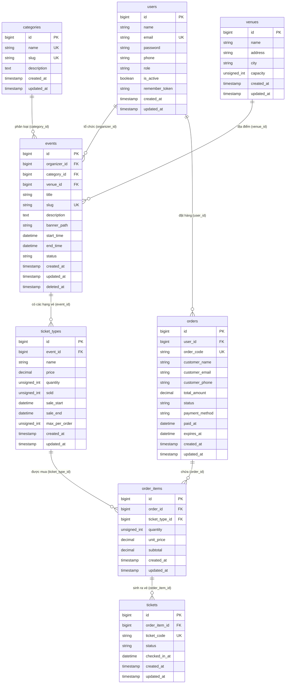

# TÀI LIỆU THIẾT KẾ CƠ SỞ DỮ LIỆU (DATABASE DESIGN SPECIFICATION)
## HỆ THỐNG QUẢN LÝ BÁN VÉ SỰ KIỆN (EVENT TICKET MANAGEMENT SYSTEM)

> **Mã tài liệu**: `DB-SPEC-02`  
> **Phiên bản**: `1.0.0`  
> **Framework & ORM**: Laravel 13 Eloquent ORM  
> **Hệ quản trị CSDL mặc định**: SQLite 3 (`database/database.sqlite`)  
> **Hỗ trợ chuyển đổi**: MySQL 8.x / MariaDB 10.x (`utf8mb4_unicode_ci`)  
> **Múi giờ lưu trữ**: `Asia/Ho_Chi_Minh` (UTC+7)

---

## MỤC LỤC
1. [Tổng quan kiến trúc cơ sở dữ liệu](#1-tổng-quan-kiến-trúc-cơ-sở-dữ-liệu)
2. [Sơ đồ quan hệ thực thể (ERD - Entity Relationship Diagram)](#2-sơ-đồ-quan-hệ-thực-thể-erd)
3. [Đặc tả chi tiết các bảng nghiệp vụ](#3-đặc-tả-chi-tiết-các-bảng-nghiệp-vụ)
   - 3.1 [Bảng `users` (Người dùng)](#31-bảng-users)
   - 3.2 [Bảng `categories` (Danh mục sự kiện)](#32-bảng-categories)
   - 3.3 [Bảng `venues` (Địa điểm tổ chức)](#33-bảng-venues)
   - 3.4 [Bảng `events` (Sự kiện)](#34-bảng-events)
   - 3.5 [Bảng `ticket_types` (Loại vé)](#35-bảng-ticket_types)
   - 3.6 [Bảng `orders` (Đơn hàng)](#36-bảng-orders)
   - 3.7 [Bảng `order_items` (Chi tiết đơn hàng)](#37-bảng-order_items)
   - 3.8 [Bảng `tickets` (Vé điện tử chi tiết)](#38-bảng-tickets)
4. [Các bảng hạ tầng hệ thống của Laravel](#4-các-bảng-hạ-tầng-hệ-thống-của-laravel)
5. [Danh mục Enums và Ràng buộc miền giá trị](#5-danh-mục-enums-và-ràng-buộc-miền-giá-trị)
6. [Thiết kế Chỉ mục (Indexes) và Tối ưu hóa truy vấn](#6-thiết-kế-chỉ-mục-indexes-và-tối-ưu-hóa-truy-vấn)
7. [Ràng buộc toàn vẹn dữ liệu (Referential Integrity)](#7-ràng-buộc-toàn-vẹn-dữ-liệu-referential-integrity)
8. [Kiểm soát đồng thời và Khóa bi quan (Concurrency Control & Pessimistic Locking)](#8-kiểm-soát-đồng-thời-và-khóa-bi-quan)
9. [Dữ liệu khởi tạo ban đầu (Database Seeders)](#9-dữ-liệu-khởi-tạo-ban-đầu-database-seeders)
10. [Hướng dẫn chuyển đổi hệ quản trị CSDL (SQLite sang MySQL)](#10-hướng-dẫn-chuyển-đổi-hệ-quản-trị-csdl)

---

## 1. TỔNG QUAN KIẾN TRÚC CƠ SỞ DỮ LIỆU

### 1.1 Triết lý thiết kế
Hệ thống Cơ sở dữ liệu (CSDL) được thiết kế theo chuẩn **Chuẩn hóa bậc 3 (3NF - Third Normal Form)**, đảm bảo:
- **Tính phi dư thừa**: Hạn chế tối đa trùng lặp thông tin, các thuộc tính phụ thuộc hàm hoàn toàn vào khóa chính.
- **Tính toàn vẹn tham chiếu**: Sử dụng ràng buộc khóa ngoại chặt chẽ (`RESTRICT` cho các bảng phân loại và địa điểm để tránh xóa nhầm dữ liệu đang hoạt động; `CASCADE` cho các quan hệ phụ thuộc cha - con như Sự kiện -> Loại vé, Đơn hàng -> Chi tiết đơn hàng -> Vé).
- **Tính nhất quán và giao dịch nguyên tử (ACID)**: Mọi thao tác đặt vé, hoàn trả vé và thanh toán đều được bọc trong `DB::transaction()` kết hợp cơ chế khóa bi quan (`lockForUpdate()`) nhằm loại bỏ 100% tình trạng **Race Condition** và **Overbooking** (bán vượt quá số lượng vé tồn).
- **Lưu vết và kiểm toán**: Mọi bảng đều có `created_at`, `updated_at`, và bảng `events` hỗ trợ `deleted_at` (Soft Delete) để bảo toàn lịch sử đơn hàng ngay cả khi sự kiện bị hủy bỏ.

### 1.2 Môi trường thực thi
- **Hệ quản trị mặc định**: **SQLite 3** (`database/database.sqlite`), không cần cài đặt thêm server DB, tương thích tuyệt đối cho môi trường chấm đồ án và kiểm thử tự động CI/CD.
- **Hệ quản trị mở rộng**: **MySQL 8.0+** hoặc **MariaDB 10.4+** (XAMPP, Laragon, Docker), mã hóa `utf8mb4`, collation `utf8mb4_unicode_ci` hỗ trợ đầy đủ tiếng Việt có dấu và biểu tượng cảm xúc.

---

## 2. SƠ ĐỒ QUAN HỆ THỰC THỂ (ERD)

### 2.1 Sơ đồ Mermaid ERD



> **Lưu ý**: Bản vẽ đồ họa gốc PlantUML chất lượng cao được lưu trữ tại [docs/diagrams/05_erd.puml](file:///d:/NMNC/event-ticket/docs/diagrams/05_erd.puml).

---

## 3. ĐẶC TẢ CHI TIẾT CÁC BẢNG NGHIỆP VỤ

### 3.1 Bảng `users`
- **Mục đích**: Lưu trữ tài khoản và thông tin xác thực của tất cả người dùng trong hệ thống (Khách hàng, Ban tổ chức, Quản trị viên).
- **Migration**: [0001_01_01_000000_create_users_table.php](file:///d:/NMNC/event-ticket/database/migrations/0001_01_01_000000_create_users_table.php)
- **Model Eloquent**: [User.php](file:///d:/NMNC/event-ticket/app/Models/User.php)

| Tên trường (Column) | Kiểu dữ liệu | Ràng buộc (Constraints) | Giá trị mặc định | Diễn giải nghiệp vụ |
|---|---|---|---|---|
| `id` | `BIGINT UNSIGNED` | **PK**, Auto Increment | | Khóa chính định danh tài khoản |
| `name` | `VARCHAR(255)` | `NOT NULL` | | Họ và tên hoặc Tên đơn vị tổ chức |
| `email` | `VARCHAR(255)` | `NOT NULL`, **UNIQUE** | | Địa chỉ email đăng nhập hệ thống |
| `password` | `VARCHAR(255)` | `NOT NULL` | | Mật khẩu băm (Bcrypt hash) |
| `phone` | `VARCHAR(255)` | `NULLABLE` | `NULL` | Số điện thoại liên hệ |
| `role` | `VARCHAR(255)` | `NOT NULL` | `'customer'` | Vai trò: `admin`, `organizer`, `customer` |
| `is_active` | `BOOLEAN` | `NOT NULL` | `true` (1) | Trạng thái: `true` (Hoạt động), `false` (Bị khóa) |
| `remember_token` | `VARCHAR(100)` | `NULLABLE` | `NULL` | Token ghi nhớ đăng nhập "Remember Me" |
| `created_at` | `TIMESTAMP` | `NULLABLE` | `NULL` | Thời điểm tạo tài khoản |
| `updated_at` | `TIMESTAMP` | `NULLABLE` | `NULL` | Thời điểm cập nhật tài khoản gần nhất |

---

### 3.2 Bảng `categories`
- **Mục đích**: Phân loại các sự kiện (Âm nhạc, Công nghệ, Thể thao, Hội thảo, v.v.).
- **Migration**: [2026_10_25_000001_create_categories_table.php](file:///d:/NMNC/event-ticket/database/migrations/2026_10_25_000001_create_categories_table.php)
- **Model Eloquent**: [Category.php](file:///d:/NMNC/event-ticket/app/Models/Category.php)

| Tên trường (Column) | Kiểu dữ liệu | Ràng buộc (Constraints) | Giá trị mặc định | Diễn giải nghiệp vụ |
|---|---|---|---|---|
| `id` | `BIGINT UNSIGNED` | **PK**, Auto Increment | | Khóa chính danh mục |
| `name` | `VARCHAR(255)` | `NOT NULL`, **UNIQUE** | | Tên danh mục (ví dụ: "Âm nhạc & Lễ hội") |
| `slug` | `VARCHAR(255)` | `NOT NULL`, **UNIQUE** | | Chuỗi định danh URL thân thiện (ví dụ: `am-nhac-le-hoi`) |
| `description` | `TEXT` | `NULLABLE` | `NULL` | Mô tả chi tiết về danh mục |
| `created_at` | `TIMESTAMP` | `NULLABLE` | `NULL` | Thời điểm tạo bản ghi |
| `updated_at` | `TIMESTAMP` | `NULLABLE` | `NULL` | Thời điểm cập nhật bản ghi |

---

### 3.3 Bảng `venues`
- **Mục đích**: Lưu thông tin địa điểm tổ chức sự kiện (Nhà hát, Sân vận động, Trung tâm hội nghị...).
- **Migration**: [2026_10_25_000002_create_venues_table.php](file:///d:/NMNC/event-ticket/database/migrations/2026_10_25_000002_create_venues_table.php)
- **Model Eloquent**: [Venue.php](file:///d:/NMNC/event-ticket/app/Models/Venue.php)

| Tên trường (Column) | Kiểu dữ liệu | Ràng buộc (Constraints) | Giá trị mặc định | Diễn giải nghiệp vụ |
|---|---|---|---|---|
| `id` | `BIGINT UNSIGNED` | **PK**, Auto Increment | | Khóa chính địa điểm |
| `name` | `VARCHAR(255)` | `NOT NULL` | | Tên địa điểm (ví dụ: "Sân vận động Quốc gia Mỹ Đình") |
| `address` | `VARCHAR(255)` | `NOT NULL` | | Địa chỉ số nhà, tên đường |
| `city` | `VARCHAR(255)` | `NOT NULL` | | Tỉnh / Thành phố (Hà Nội, TP. Hồ Chí Minh, Đà Nẵng...) |
| `capacity` | `INT UNSIGNED` | `NOT NULL` | | Sức chứa tối đa của địa điểm (số người) |
| `created_at` | `TIMESTAMP` | `NULLABLE` | `NULL` | Thời điểm tạo bản ghi |
| `updated_at` | `TIMESTAMP` | `NULLABLE` | `NULL` | Thời điểm cập nhật bản ghi |

---

### 3.4 Bảng `events`
- **Mục đích**: Lưu thông tin sự kiện do Ban tổ chức khởi tạo và được Admin phê duyệt.
- **Migration**: [2026_10_25_000003_create_events_table.php](file:///d:/NMNC/event-ticket/database/migrations/2026_10_25_000003_create_events_table.php)
- **Model Eloquent**: [Event.php](file:///d:/NMNC/event-ticket/app/Models/Event.php)

| Tên trường (Column) | Kiểu dữ liệu | Ràng buộc (Constraints) | Giá trị mặc định | Diễn giải nghiệp vụ |
|---|---|---|---|---|
| `id` | `BIGINT UNSIGNED` | **PK**, Auto Increment | | Khóa chính định danh sự kiện |
| `organizer_id` | `BIGINT UNSIGNED` | `NOT NULL`, **FK** -> `users(id)` | | Mã ban tổ chức (ON DELETE CASCADE) |
| `category_id` | `BIGINT UNSIGNED` | `NOT NULL`, **FK** -> `categories(id)` | | Mã danh mục sự kiện (ON DELETE RESTRICT) |
| `venue_id` | `BIGINT UNSIGNED` | `NOT NULL`, **FK** -> `venues(id)` | | Mã địa điểm tổ chức (ON DELETE RESTRICT) |
| `title` | `VARCHAR(255)` | `NOT NULL` | | Tên/Tiêu đề sự kiện |
| `slug` | `VARCHAR(255)` | `NOT NULL`, **UNIQUE** | | Đường dẫn tĩnh thân thiện SEO |
| `description` | `TEXT` | `NOT NULL` | | Nội dung giới thiệu và lịch trình sự kiện |
| `banner_path` | `VARCHAR(255)` | `NULLABLE` | `NULL` | Đường dẫn file ảnh đại diện sự kiện |
| `start_time` | `DATETIME` | `NOT NULL` | | Thời điểm khai mạc sự kiện |
| `end_time` | `DATETIME` | `NOT NULL` | | Thời điểm bế mạc sự kiện |
| `status` | `VARCHAR(255)` | `NOT NULL` | `'draft'` | Trạng thái: `draft`, `published`, `cancelled`, `completed` |
| `created_at` | `TIMESTAMP` | `NULLABLE` | `NULL` | Thời điểm tạo sự kiện |
| `updated_at` | `TIMESTAMP` | `NULLABLE` | `NULL` | Thời điểm cập nhật sự kiện |
| `deleted_at` | `TIMESTAMP` | `NULLABLE` | `NULL` | Thời điểm xóa mềm (Soft Delete) |

*Chỉ mục bổ trợ:*
- `INDEX events_status_start_time_index` trên cặp cột `(status, start_time)`.
- `INDEX events_category_id_index` trên cột `category_id`.

---

### 3.5 Bảng `ticket_types`
- **Mục đích**: Định nghĩa các hạng vé bán ra cho từng sự kiện (Standard, VIP, Early Bird, VVIP...) kèm theo số lượng phát hành, số lượng đã bán/đã giữ chỗ và khoảng thời gian mở bán.
- **Migration**: [2026_10_25_000004_create_ticket_types_table.php](file:///d:/NMNC/event-ticket/database/migrations/2026_10_25_000004_create_ticket_types_table.php)
- **Model Eloquent**: [TicketType.php](file:///d:/NMNC/event-ticket/app/Models/TicketType.php)

| Tên trường (Column) | Kiểu dữ liệu | Ràng buộc (Constraints) | Giá trị mặc định | Diễn giải nghiệp vụ |
|---|---|---|---|---|
| `id` | `BIGINT UNSIGNED` | **PK**, Auto Increment | | Khóa chính loại vé |
| `event_id` | `BIGINT UNSIGNED` | `NOT NULL`, **FK** -> `events(id)` | | Thuộc sự kiện nào (ON DELETE CASCADE) |
| `name` | `VARCHAR(255)` | `NOT NULL` | | Tên hạng vé (ví dụ: "Vé VIP Khu A", "Vé Phổ Thông") |
| `price` | `DECIMAL(12, 0)` | `NOT NULL` | | Đơn giá vé (đơn vị: VNĐ) |
| `quantity` | `INT UNSIGNED` | `NOT NULL` | | Tổng số lượng vé phát hành |
| `sold` | `INT UNSIGNED` | `NOT NULL` | `0` | Số lượng vé đã bán hoặc đang trong phiên giữ chỗ |
| `sale_start` | `DATETIME` | `NOT NULL` | | Thời điểm bắt đầu mở bán |
| `sale_end` | `DATETIME` | `NOT NULL` | | Thời điểm kết thúc mở bán |
| `max_per_order`| `INT UNSIGNED` | `NOT NULL` | `10` | Số vé tối đa cho phép mua trong 1 đơn hàng |
| `created_at` | `TIMESTAMP` | `NULLABLE` | `NULL` | Thời điểm tạo loại vé |
| `updated_at` | `TIMESTAMP` | `NULLABLE` | `NULL` | Thời điểm cập nhật loại vé |

*Thuộc tính ảo (Accessors) trong Model:*
- `remaining_tickets`: Tính toán số vé còn khả dụng = `max(0, quantity - sold)`.
- `is_on_sale`: Boolean kiểm tra `now()->between(sale_start, sale_end) && remaining_tickets > 0`.

---

### 3.6 Bảng `orders`
- **Mục đích**: Quản lý đơn hàng mua vé của khách hàng, trạng thái thanh toán và thời hạn giữ chỗ 15 phút.
- **Migration**: [2026_10_25_000005_create_orders_table.php](file:///d:/NMNC/event-ticket/database/migrations/2026_10_25_000005_create_orders_table.php)
- **Model Eloquent**: [Order.php](file:///d:/NMNC/event-ticket/app/Models/Order.php)

| Tên trường (Column) | Kiểu dữ liệu | Ràng buộc (Constraints) | Giá trị mặc định | Diễn giải nghiệp vụ |
|---|---|---|---|---|
| `id` | `BIGINT UNSIGNED` | **PK**, Auto Increment | | Khóa chính đơn hàng |
| `user_id` | `BIGINT UNSIGNED` | `NOT NULL`, **FK** -> `users(id)` | | Khách hàng đặt mua (ON DELETE CASCADE) |
| `order_code` | `VARCHAR(255)` | `NOT NULL`, **UNIQUE** | | Mã đơn hàng độc nhất định dạng `ORD-XXXXXXXX` |
| `customer_name` | `VARCHAR(255)` | `NOT NULL` | | Họ tên người mua (lưu snapshot tại thời điểm mua) |
| `customer_email`| `VARCHAR(255)` | `NOT NULL` | | Email nhận thông báo vé điện tử |
| `customer_phone`| `VARCHAR(255)` | `NULLABLE` | `NULL` | Số điện thoại liên hệ nhận vé |
| `total_amount` | `DECIMAL(12, 0)` | `NOT NULL` | | Tổng giá trị đơn hàng (VNĐ) |
| `status` | `VARCHAR(255)` | `NOT NULL` | `'pending'` | Trạng thái: `pending`, `paid`, `cancelled`, `refunded` |
| `payment_method`| `VARCHAR(255)` | `NULLABLE` | `NULL` | Phương thức: `bank_transfer`, `momo`, `card` |
| `paid_at` | `DATETIME` | `NULLABLE` | `NULL` | Thời điểm hoàn tất giao dịch thanh toán |
| `expires_at` | `DATETIME` | `NULLABLE` | `NULL` | Thời điểm hết hạn giữ chỗ (15 phút từ lúc đặt) |
| `created_at` | `TIMESTAMP` | `NULLABLE` | `NULL` | Thời điểm tạo đơn hàng |
| `updated_at` | `TIMESTAMP` | `NULLABLE` | `NULL` | Thời điểm cập nhật đơn hàng |

*Chỉ mục bổ trợ:*
- `INDEX orders_user_id_status_index` trên cặp cột `(user_id, status)` phục vụ tra cứu lịch sử đơn hàng cá nhân siêu tốc.

---

### 3.7 Bảng `order_items`
- **Mục đích**: Lưu chi tiết từng loại vé và số lượng trong một đơn hàng (Bảng quan hệ N-N giữa `orders` và `ticket_types`).
- **Migration**: [2026_10_25_000006_create_order_items_table.php](file:///d:/NMNC/event-ticket/database/migrations/2026_10_25_000006_create_order_items_table.php)
- **Model Eloquent**: [OrderItem.php](file:///d:/NMNC/event-ticket/app/Models/OrderItem.php)

| Tên trường (Column) | Kiểu dữ liệu | Ràng buộc (Constraints) | Giá trị mặc định | Diễn giải nghiệp vụ |
|---|---|---|---|---|
| `id` | `BIGINT UNSIGNED` | **PK**, Auto Increment | | Khóa chính dòng chi tiết đơn hàng |
| `order_id` | `BIGINT UNSIGNED` | `NOT NULL`, **FK** -> `orders(id)` | | Đơn hàng sở hữu (ON DELETE CASCADE) |
| `ticket_type_id` | `BIGINT UNSIGNED` | `NOT NULL`, **FK** -> `ticket_types(id)` | | Loại vé được chọn mua (ON DELETE CASCADE) |
| `quantity` | `INT UNSIGNED` | `NOT NULL` | | Số lượng vé đặt mua |
| `unit_price` | `DECIMAL(12, 0)` | `NOT NULL` | | Đơn giá tại thời điểm đặt hàng |
| `subtotal` | `DECIMAL(12, 0)` | `NOT NULL` | | Thành tiền dòng = `quantity * unit_price` |
| `created_at` | `TIMESTAMP` | `NULLABLE` | `NULL` | Thời điểm tạo dòng chi tiết |
| `updated_at` | `TIMESTAMP` | `NULLABLE` | `NULL` | Thời điểm cập nhật dòng chi tiết |

---

### 3.8 Bảng `tickets`
- **Mục đích**: Lưu từng chiếc vé điện tử cụ thể phát hành cho khách sau khi thanh toán thành công, phục vụ kiểm soát cổng (Check-in). Mỗi chiếc vé sở hữu 1 mã định danh `ticket_code` độc nhất.
- **Migration**: [2026_10_25_000007_create_tickets_table.php](file:///d:/NMNC/event-ticket/database/migrations/2026_10_25_000007_create_tickets_table.php)
- **Model Eloquent**: [Ticket.php](file:///d:/NMNC/event-ticket/app/Models/Ticket.php)

| Tên trường (Column) | Kiểu dữ liệu | Ràng buộc (Constraints) | Giá trị mặc định | Diễn giải nghiệp vụ |
|---|---|---|---|---|
| `id` | `BIGINT UNSIGNED` | **PK**, Auto Increment | | Khóa chính chiếc vé |
| `order_item_id` | `BIGINT UNSIGNED` | `NOT NULL`, **FK** -> `order_items(id)` | | Thuộc chi tiết đơn hàng nào (ON DELETE CASCADE) |
| `ticket_code` | `VARCHAR(255)` | `NOT NULL`, **UNIQUE** | | Mã vé duy nhất dùng để quét cổng `TKT-XXXXXXXXXX` |
| `status` | `VARCHAR(255)` | `NOT NULL` | `'valid'` | Trạng thái: `valid` (hợp lệ), `used` (đã soát vé), `cancelled` (đã hủy) |
| `checked_in_at` | `DATETIME` | `NULLABLE` | `NULL` | Thời điểm quét vé vào cổng thực tế |
| `created_at` | `TIMESTAMP` | `NULLABLE` | `NULL` | Thời điểm phát hành vé |
| `updated_at` | `TIMESTAMP` | `NULLABLE` | `NULL` | Thời điểm cập nhật vé |

---

## 4. CÁC BẢNG HẠ TẦNG HỆ THỐNG CỦA LARAVEL

Ngoài 8 bảng nghiệp vụ chính, cơ sở dữ liệu tích hợp sẵn các bảng hệ thống tiêu chuẩn của Laravel:

1. **`sessions`**: Lưu trữ phiên làm việc của người dùng khi cấu hình `SESSION_DRIVER=database`, hỗ trợ ngắt phiên tức thời khi Admin khóa tài khoản:
   - Cột: `id` (PK, string), `user_id` (FK index), `ip_address`, `user_agent`, `payload`, `last_activity` (index).
2. **`password_reset_tokens`**: Lưu mã token khôi phục mật khẩu qua email:
   - Cột: `email` (PK, string), `token`, `created_at`.
3. **`cache` & `cache_locks`**: Quản lý bộ nhớ đệm và khóa phân tán khi cấu hình `CACHE_STORE=database`:
   - Bảng `cache`: `key` (PK, string), `value`, `expiration` (int).
   - Bảng `cache_locks`: `key` (PK, string), `owner`, `expiration` (int).
4. **`jobs`, `job_batches`, `failed_jobs`**: Hệ thống hàng đợi (Queue Worker) xử lý các tác vụ nền không đồng bộ (gửi email thông báo, xuất báo cáo...).

---

## 5. DANH MỤC ENUMS VÀ RÀNG BUỘC MIỀN GIÁ TRỊ

Hệ thống áp dụng chuẩn **PHP 8.3 Backed Enums** tương thích 100% với cột kiểu `VARCHAR(255)` trong database:

### 5.1 `UserRole` (`app/Enums/UserRole.php`)
```php
enum UserRole: string {
    case ADMIN = 'admin';         // Quản trị viên toàn hệ thống
    case ORGANIZER = 'organizer'; // Ban tổ chức sự kiện
    case CUSTOMER = 'customer';   // Khách hàng mua vé
}
```

### 5.2 `EventStatus` (`app/Enums/EventStatus.php`)
```php
enum EventStatus: string {
    case DRAFT = 'draft';         // Sự kiện đang soạn thảo (chỉ Organizer thấy)
    case PUBLISHED = 'published'; // Sự kiện đã phê duyệt và công khai trên Storefront
    case CANCELLED = 'cancelled'; // Sự kiện đã bị hủy bỏ
    case COMPLETED = 'completed'; // Sự kiện đã kết thúc thành công
}
```

### 5.3 `OrderStatus` (`app/Enums/OrderStatus.php`)
```php
enum OrderStatus: string {
    case PENDING = 'pending';     // Đang chờ thanh toán (giữ chỗ 15 phút)
    case PAID = 'paid';           // Đã thanh toán thành công (vé đã kích hoạt)
    case CANCELLED = 'cancelled'; // Đơn hàng đã bị hủy (hết hạn hoặc khách tự hủy)
    case REFUNDED = 'refunded';   // Đơn hàng đã được hoàn tiền
}
```

### 5.4 `TicketStatus` (`app/Enums/TicketStatus.php`)
```php
enum TicketStatus: string {
    case VALID = 'valid';         // Vé hợp lệ, chưa vào cổng
    case USED = 'used';           // Vé đã được check-in quét tại cổng
    case CANCELLED = 'cancelled'; // Vé đã bị hủy bỏ theo đơn hàng
}
```

---

## 6. THIẾT KẾ CHỈ MỤC (INDEXES) VÀ TỐI ƯU HÓA TRUY VẤN

Nhằm đảm bảo tốc độ phản hồi < 200ms ngay cả khi hệ thống có hàng vạn đơn hàng và vé:

| Tên bảng | Kiểu chỉ mục | Các cột tham gia | Mục đích tối ưu |
|---|---|---|---|
| `users` | `UNIQUE` | `email` | Xác thực đăng nhập tức thời, chống trùng lặp email |
| `categories` | `UNIQUE` | `name`, `slug` | Tìm kiếm danh mục, phân giải đường dẫn tĩnh |
| `events` | `UNIQUE` | `slug` | Phân giải URL trang chi tiết sự kiện `events/{event:slug}` |
| `events` | `INDEX` (Composite)| `(status, start_time)` | Tối ưu hóa truy vấn lọc trang chủ: `WHERE status = 'published' ORDER BY start_time ASC` |
| `events` | `INDEX` | `category_id` | Tăng tốc truy vấn lọc sự kiện theo danh mục |
| `orders` | `UNIQUE` | `order_code` | Phân giải URL chi tiết đơn hàng `orders/{order:order_code}` |
| `orders` | `INDEX` (Composite)| `(user_id, status)` | Tăng tốc hiển thị danh sách "Đơn hàng của tôi" theo từng trạng thái |
| `tickets` | `UNIQUE` | `ticket_code` | Tra cứu tức thời trong nghiệp vụ Check-in soát vé cổng (`O(1)` query) |
| `sessions` | `INDEX` | `user_id`, `last_activity` | Dọn dẹp phiên và kiểm tra trạng thái hoạt động |

---

## 7. RÀNG BUỘC TOÀN VẸN DỮ LIỆU (REFERENTIAL INTEGRITY)

| Bảng con | Khóa ngoại | Tham chiếu đến | Hành vi khi XÓA (ON DELETE) | Hành vi khi CẬP NHẬT | Lý do thiết kế |
|---|---|---|:---:|:---:|---|
| `events` | `organizer_id` | `users(id)` | `CASCADE` | `CASCADE` | Xóa tài khoản organizer sẽ dọn dẹp các sự kiện phụ thuộc |
| `events` | `category_id` | `categories(id)` | **`RESTRICT`** | `CASCADE` | **Bảo vệ toàn vẹn**: Tuyệt đối không cho phép xóa Danh mục nếu đang có sự kiện liên kết |
| `events` | `venue_id` | `venues(id)` | **`RESTRICT`** | `CASCADE` | **Bảo vệ toàn vẹn**: Tuyệt đối không cho phép xóa Địa điểm nếu đang có sự kiện liên kết |
| `ticket_types` | `event_id` | `events(id)` | `CASCADE` | `CASCADE` | Xóa sự kiện sẽ tự động xóa các loại vé trực thuộc |
| `orders` | `user_id` | `users(id)` | `CASCADE` | `CASCADE` | Dọn dẹp đơn hàng theo tài khoản |
| `order_items` | `order_id` | `orders(id)` | `CASCADE` | `CASCADE` | Xóa đơn hàng sẽ xóa các dòng chi tiết |
| `order_items` | `ticket_type_id` | `ticket_types(id)` | `CASCADE` | `CASCADE` | Toàn vẹn liên kết loại vé |
| `tickets` | `order_item_id` | `order_items(id)` | `CASCADE` | `CASCADE` | Xóa chi tiết đơn hàng sẽ tự động xóa các vé điện tử liên kết |

---

## 8. KIỂM SOÁT ĐỒNG THỜI VÀ KHÓA BI QUAN (CONCURRENCY CONTROL)

### 8.1 Vấn đề Race Condition trong bán vé
Khi một sự kiện chỉ còn **2 vé cuối cùng**, nhưng có **10 khách hàng** cùng nhấn nút "Đặt vé" tại cùng một phần nghìn giây:
- Nếu chỉ đọc `sold` thông thường bằng lệnh `SELECT`, cả 10 người đều thấy còn vé và thực hiện ghi nhận đơn hàng.
- Kết quả: Hệ thống bị **Bán vượt số lượng (Overbooking)**, dẫn đến tranh chấp nghiêm trọng ngoài thực tế.

### 8.2 Giải pháp kiến trúc: Transaction + `lockForUpdate()`
Dự án áp dụng giải pháp chuẩn doanh nghiệp tại [OrderService.php](file:///d:/NMNC/event-ticket/app/Services/OrderService.php):

```php
return DB::transaction(function () use ($user, $customerData, $ticketsData) {
    // 1. Duyệt từng loại vé và kích hoạt khóa độc quyền (Pessimistic Write Lock)
    foreach ($ticketsData as $ticketTypeId => $qty) {
        $ticketType = TicketType::where('id', $ticketTypeId)
            ->lockForUpdate() // Khóa hàng dữ liệu này cho đến khi Transaction kết thúc
            ->firstOrFail();

        // 2. Kiểm tra tồn kho khả dụng ngay trên dữ liệu mới nhất
        $available = $ticketType->quantity - $ticketType->sold;
        if ($available < $qty) {
            throw new BusinessException("Hạng vé '{$ticketType->name}' chỉ còn {$available} vé khả dụng.");
        }

        // 3. Tăng ngay số lượng đã bán/giữ chỗ
        $ticketType->increment('sold', $qty);
    }

    // 4. Khởi tạo đơn hàng với thời hạn giữ chỗ 15 phút
    $order = Order::create([
        'user_id' => $user->id,
        'order_code' => Order::generateUniqueCode(),
        'status' => OrderStatus::PENDING->value,
        'expires_at' => now()->addMinutes(15),
        // ...
    ]);

    return $order;
});
```

### 8.3 Cơ chế hoàn trả vé khi quá hạn (Restock)
- Khi đơn hàng `pending` vượt quá `expires_at`, lệnh `php artisan orders:expire-pending` hoặc cơ chế lazy check sẽ tự động thực hiện:
  1. Chuyển `orders.status` thành `'cancelled'`.
  2. Duyệt qua từng dòng `order_items`, gọi `$ticketType->decrement('sold', $item->quantity)` để hoàn trả vé về kho cho khách hàng khác mua.

---

## 9. DỮ LIỆU KHỞI TẠO BAN ĐẦU (DATABASE SEEDERS)

Khi thực thi lệnh `php artisan migrate:fresh --seed --force`, hệ thống tự động nạp cơ sở dữ liệu mẫu chuẩn hóa:

1. **`UserSeeder`**: Khởi tạo 8 người dùng đại diện cho 4 vai trò:
   - 1 Quản trị viên (`admin@eventhub.vn`)
   - 2 Ban tổ chức (`organizer@eventhub.vn`, `organizer2@eventhub.vn`)
   - 3 Khách hàng (`customer@gmail.com`, `customer2@gmail.com`, `customer3@gmail.com`)
   - 2 Tài khoản thử nghiệm bị khóa (`blocked@gmail.com`, `organizer_blocked@eventhub.vn`)
   - *Mật khẩu mặc định*: `password`
2. **`CategorySeeder`**: Khởi tạo 5 danh mục sự kiện chuẩn:
   - Âm nhạc & Concert (`am-nhac-concert`)
   - Hội thảo & Workshop (`hoi-thao-workshop`)
   - Triển lãm & Nghệ thuật (`trien-lam-nghe-thuat`)
   - Thể thao & Giải đấu (`the-thao-giai-dau`)
   - Sân khấu & Kịch nghệ (`san-khau-kich-nghe`)
3. **`VenueSeeder`**: Khởi tạo 5 địa điểm tổ chức tiêu chuẩn tại các thành phố lớn:
   - Trung tâm Hội nghị Quốc gia (Hà Nội - 3.800 chỗ)
   - Sân vận động Quốc gia Mỹ Đình (Hà Nội - 40.000 chỗ)
   - Nhà thi đấu Quân khu 7 (TP. Hồ Chí Minh - 5.000 chỗ)
   - Nhà hát Thành phố Hồ Chí Minh (TP. Hồ Chí Minh - 500 chỗ)
   - Cung Thể thao Tiên Sơn (Đà Nẵng - 6.500 chỗ)
4. **`EventSeeder`**: Khởi tạo 8 sự kiện đa dạng trạng thái:
   - 5 sự kiện `published` đang mở bán vé.
   - 1 sự kiện `draft` đang chuẩn bị.
   - 1 sự kiện `cancelled` đã hủy.
   - 1 sự kiện `completed` đã kết thúc.
   - Đi kèm từ 2 đến 3 hạng vé (`ticket_types`) cho mỗi sự kiện (Standard, VIP, VVIP).
5. **`OrderSeeder`**: Khởi tạo 4 đơn hàng mẫu kèm các dòng chi tiết và các vé điện tử phát hành sẵn (`valid`, `used`) phục vụ việc chạy demo soát vé tại cổng.

---

## 10. HƯỚNG DẪN CHUYỂN ĐỔI HỆ QUẢN TRỊ CSDL

### 10.1 Sử dụng SQLite (Mặc định)
Không cần cài đặt thêm bất kỳ dịch vụ nào:
```env
DB_CONNECTION=sqlite
# DB_DATABASE=d:/NMNC/event-ticket/database/database.sqlite
```

### 10.2 Chuyển sang MySQL (XAMPP / Laragon / Server)
1. Khởi động MySQL trên XAMPP hoặc Laragon.
2. Tạo database mới:
   ```sql
   CREATE DATABASE event_ticket CHARACTER SET utf8mb4 COLLATE utf8mb4_unicode_ci;
   ```
3. Chỉnh sửa file `.env`:
   ```env
   DB_CONNECTION=mysql
   DB_HOST=127.0.0.1
   DB_PORT=3306
   DB_DATABASE=event_ticket
   DB_USERNAME=root
   DB_PASSWORD=
   ```
4. Khởi tạo cấu trúc và nạp dữ liệu:
   ```bash
   php artisan migrate:fresh --seed --force
   ```

---
*Tài liệu được biên soạn và bảo trì bởi Bộ phận Kiến trúc & Kỹ thuật Cơ sở dữ liệu (Database Engineering).*
