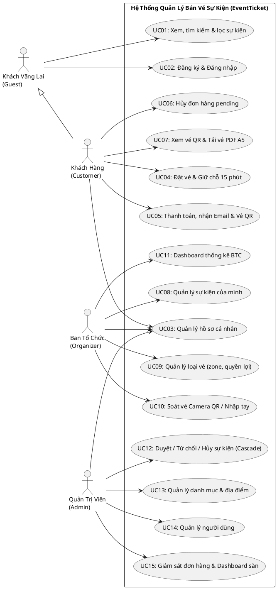
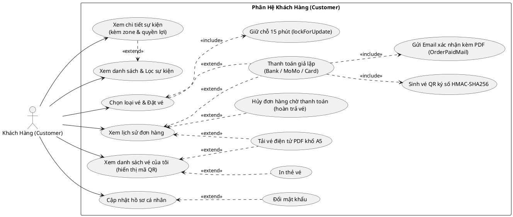
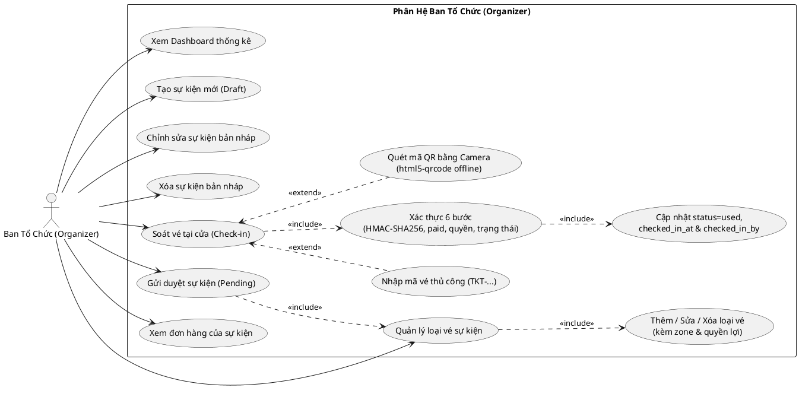
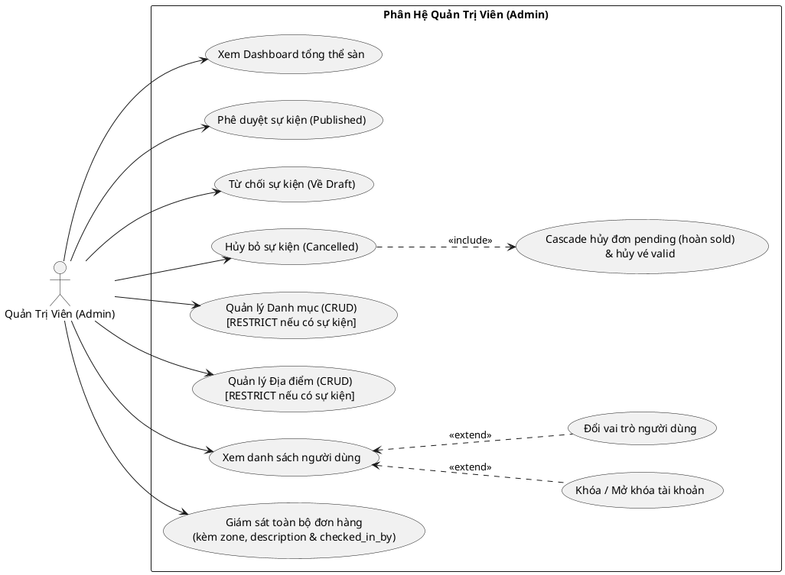
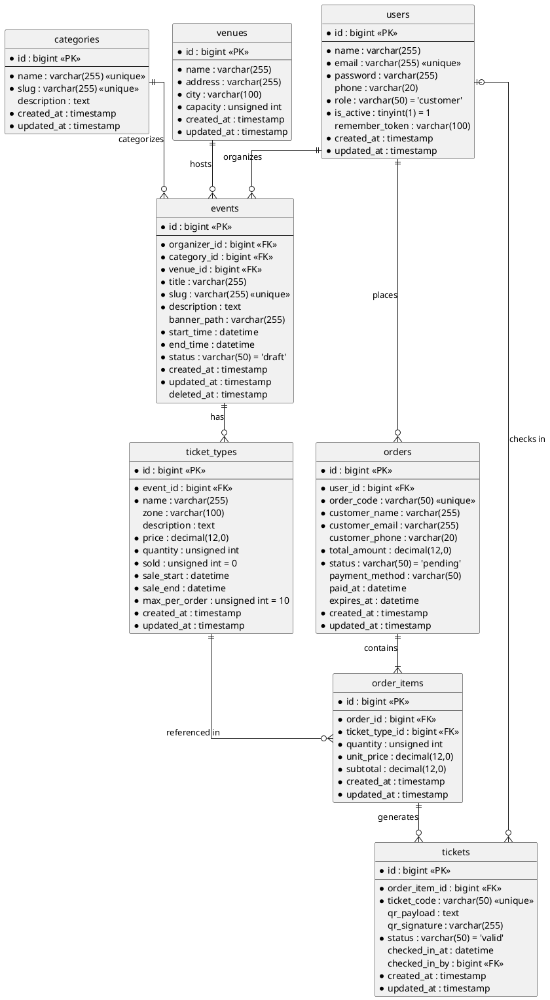
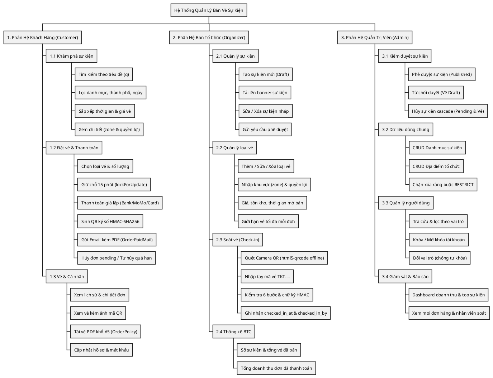
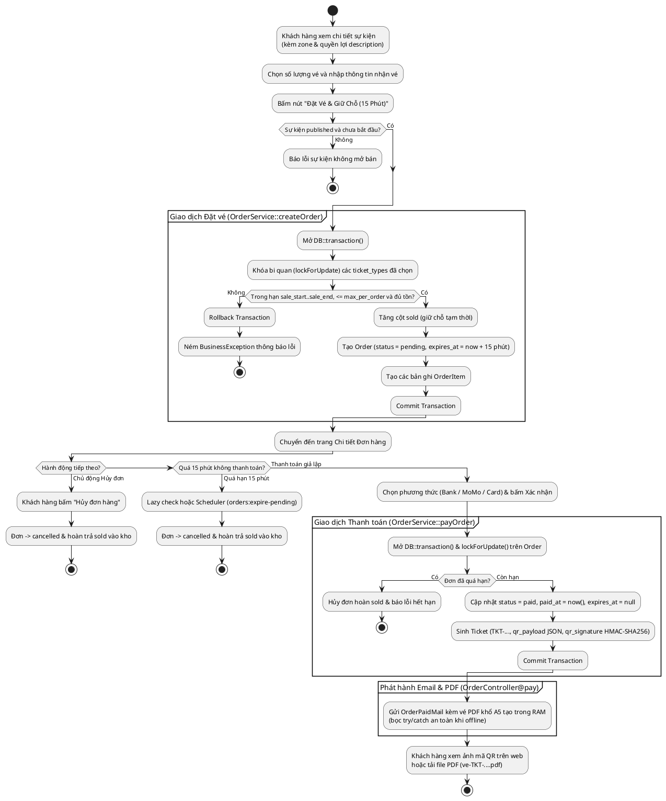
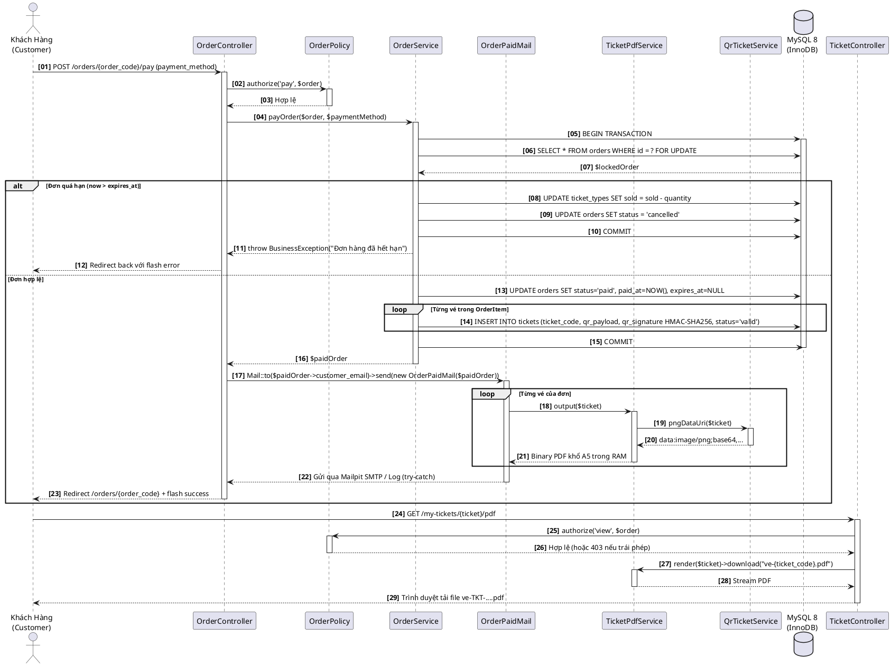
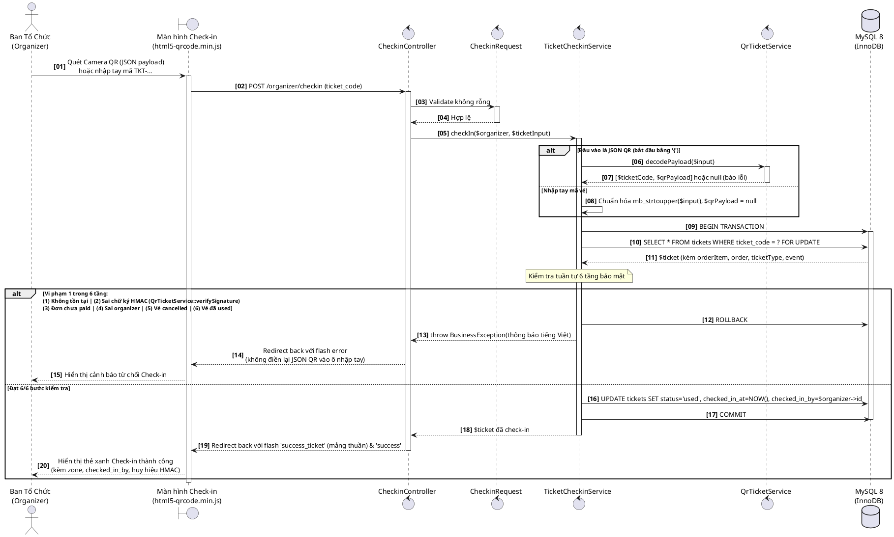
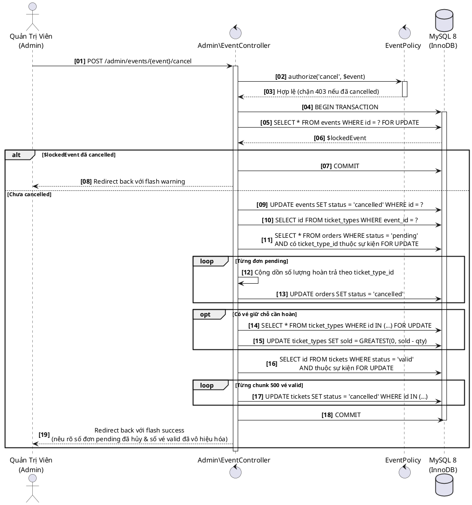

# BỘ PROMPT & MÃ UML CHO DRAW.IO — HỆ THỐNG QUẢN LÝ BÁN VÉ SỰ KIỆN

> **Mục đích:** Lưu trữ đầy đủ các **Prompt tạo sơ đồ (AI Prompt)** và **Mã nguồn PlantUML chuẩn mới nhất** (đã đồng bộ 5 cột CSDL mới và các luồng QR HMAC, Camera Check-in, PDF A5, Email Mailpit, Admin Cancel Cascade) để bạn mở trong **draw.io** (`app.diagrams.net` hoặc Draw.io Desktop) và tự xuất file `.drawio` + ảnh `.png`.

---

## HƯỚNG DẪN SỬ DỤNG NHANH TRONG DRAW.IO

### Cách 1: Dán mã PlantUML (Khuyên dùng — chuẩn 100% từng bảng, từng cột, từng bước)
1. Mở [https://app.diagrams.net](https://app.diagrams.net) hoặc ứng dụng **Draw.io Desktop**.
2. Chọn **`Arrange` > `Insert` > `Advanced` > `PlantUML...`** *(Tiếng Việt: **Sắp xếp > Chèn > Nâng cao > PlantUML...**)*.
3. Sao chép toàn bộ khối mã `@startuml ... @enduml` (hoặc `@startwbs ... @endwbs`) của sơ đồ tương ứng bên dưới rồi dán vào hộp thoại và bấm **Insert**.
4. Chỉnh sửa lại màu sắc/vị trí nếu muốn, sau đó:
   - Lưu file nguồn `.drawio` vào `docs/diagrams/<tên_file>.drawio`
   - Xuất ảnh PNG (`File > Export as > PNG...`, zoom 200%, Transparent hoặc nền trắng) vào `docs/diagrams/images/<tên_file>.png`.

### Cách 2: Dùng Prompt AI trong draw.io (hoặc công cụ AI sinh sơ đồ)
1. Trong draw.io, nhấn dấu **`+` (More Shapes / Insert)** -> chọn tính năng **Generate / AI Diagram** (hoặc dùng ChatGPT/Claude/Gemini sinh file `.drawio` XML rồi mở bằng draw.io).
2. Sao chép phần **Prompt AI** ngay phía trên mỗi sơ đồ bên dưới để sinh khung sơ đồ nhanh, sau đó tinh chỉnh trực quan.

---

## MỤC LỤC CÁC SƠ ĐỒ CẦN TẠO

| STT | Tên File `.drawio` gợi ý | Ảnh `.png` tương ứng | Nội dung |
| :-: | :--- | :--- | :--- |
| 1 | `01_usecase_tong_quan.drawio` | `01_usecase_tong_quan.png` | Use Case tổng quan 4 vai trò (cập nhật QR/PDF/Email/Camera/Cascade) |
| 2 | `02_usecase_khach_hang.drawio` | `02_usecase_khach_hang.png` | Use Case chi tiết Phân hệ Khách hàng |
| 3 | `03_usecase_ban_to_chuc.drawio` | `03_usecase_ban_to_chuc.png` | Use Case chi tiết Phân hệ Ban tổ chức |
| 4 | `04_usecase_quan_tri.drawio` | `04_usecase_quan_tri.png` | Use Case chi tiết Phân hệ Quản trị viên |
| 5 | `05_erd.drawio` | `05_erd.png` | Sơ đồ ERD 8 bảng MySQL 8 (kèm 5 cột mới & FK `checked_in_by`) |
| 6 | `06_so_do_chuc_nang.drawio` | `06_so_do_chuc_nang.png` | Sơ đồ phân rã chức năng WBS toàn hệ thống |
| 7 | `07_activity_mua_ve.drawio` | `07_activity_mua_ve.png` | Activity Diagram luồng đặt vé, giữ chỗ, thanh toán, QR, PDF & Email |
| 8 | `08_sequence_thanh_toan.drawio` | `08_sequence_thanh_toan.png` | Sequence Diagram luồng thanh toán, ký QR HMAC, gửi Mail & xuất PDF |
| 9 | `09_sequence_checkin_qr.drawio` | `09_sequence_checkin_qr.png` | Sequence Diagram luồng soát vé Camera QR / nhập tay 6 bước |
| 10 | `10_sequence_admin_cancel_cascade.drawio` | `10_sequence_admin_cancel_cascade.png` | Sequence Diagram luồng Admin hủy sự kiện cascade |

---

## 1. Use Case Tổng quan (`01_usecase_tong_quan.drawio`)

### Prompt AI cho draw.io
> Vẽ sơ đồ UML Use Case Diagram tổng quan cho **Hệ Thống Quản Lý Bán Vé Sự Kiện (EventTicket)** bằng tiếng Việt, hướng từ trái sang phải.
> - Có 4 Actor: `Khách Vãng Lai (Guest)`, `Khách Hàng (Customer)` kế thừa từ Guest, `Ban Tổ Chức (Organizer)`, `Quản Trị Viên (Admin)`.
> - Các Use Case trong ranh giới hệ thống:
>   - Guest: `UC01: Xem, tìm kiếm & lọc sự kiện`, `UC02: Đăng ký & Đăng nhập`.
>   - Customer: `UC03: Quản lý hồ sơ cá nhân`, `UC04: Đặt vé & Giữ chỗ 15 phút`, `UC05: Thanh toán, nhận Email & Vé QR/PDF`, `UC06: Xem & Hủy đơn hàng pending`, `UC07: Xem vé QR & Tải vé PDF A5`.
>   - Organizer: `UC03: Quản lý hồ sơ cá nhân`, `UC08: Quản lý sự kiện của mình`, `UC09: Quản lý loại vé (kèm zone & quyền lợi)`, `UC10: Soát vé Check-in (Camera QR & Nhập tay)`, `UC11: Xem Dashboard thống kê`.
>   - Admin: `UC03: Quản lý hồ sơ cá nhân`, `UC12: Duyệt, từ chối & Hủy sự kiện (Cascade)`, `UC13: Quản lý danh mục & địa điểm`, `UC14: Quản lý người dùng`, `UC15: Giám sát đơn hàng & Dashboard toàn sàn`.

### Mã PlantUML dán vào draw.io

---

## 2. Use Case Chi tiết Khách hàng (`02_usecase_khach_hang.drawio`)

### Prompt AI cho draw.io
> Vẽ sơ đồ UML Use Case Diagram cho **Phân Hệ Khách Hàng (Customer)** bằng tiếng Việt, hướng từ trái sang phải.
> - Actor: `Khách Hàng (Customer)`.
> - Use cases:
>   - `Xem danh sách & Lọc sự kiện` <-- `<<extend>>` `Xem chi tiết sự kiện (kèm zone & quyền lợi)`.
>   - `Chọn loại vé & Đặt vé` ..> `<<include>>` `Giữ chỗ 15 phút (lockForUpdate)`.
>   - `Chọn loại vé & Đặt vé` <-- `<<extend>>` `Thanh toán giả lập (Bank / MoMo / Card)`.
>   - `Thanh toán giả lập` ..> `<<include>>` `Sinh vé QR ký số HMAC-SHA256` và `<<include>>` `Gửi Email xác nhận kèm PDF (OrderPaidMail)`.
>   - `Xem lịch sử đơn hàng` <-- `<<extend>>` `Thanh toán giả lập` và `<<extend>>` `Hủy đơn hàng chờ thanh toán (hoàn vé)`.
>   - `Xem danh sách vé của tôi (hiển thị QR)` <-- `<<extend>>` `Tải vé điện tử PDF khổ A5` và `<<extend>>` `In thẻ vé`.
>   - `Cập nhật hồ sơ cá nhân` <-- `<<extend>>` `Đổi mật khẩu`.

### Mã PlantUML dán vào draw.io

---

## 3. Use Case Chi tiết Ban tổ chức (`03_usecase_ban_to_chuc.drawio`)

### Prompt AI cho draw.io
> Vẽ sơ đồ UML Use Case Diagram cho **Phân Hệ Ban Tổ Chức (Organizer)** bằng tiếng Việt, hướng từ trái sang phải.
> - Actor: `Ban Tổ Chức (Organizer)`.
> - Use cases: `Xem Dashboard thống kê`, `Tạo sự kiện mới (Draft)`, `Chỉnh sửa sự kiện bản nháp`, `Xóa sự kiện bản nháp`, `Quản lý loại vé sự kiện` (`<<include>>` `Thêm / Sửa / Xóa loại vé kèm zone & description`), `Gửi duyệt sự kiện (Pending)` (`<<include>>` `Quản lý loại vé sự kiện`), `Xem đơn hàng của sự kiện`, `Soát vé tại cửa (Check-in)` có 2 nhánh `<<extend>>` là `Quét mã QR bằng Camera (html5-qrcode offline)` và `Nhập mã vé thủ công (TKT-...)`, đồng thời `Soát vé` `<<include>>` `Xác thực 6 bước (tồn tại, HMAC-SHA256, paid, sở hữu, chưa hủy, chưa dùng)` và `<<include>>` `Cập nhật used, checked_in_at & checked_in_by`.

### Mã PlantUML dán vào draw.io

---

## 4. Use Case Chi tiết Quản trị viên (`04_usecase_quan_tri.drawio`)

### Prompt AI cho draw.io
> Vẽ sơ đồ UML Use Case Diagram cho **Phân Hệ Quản Trị Viên (Admin)** bằng tiếng Việt, hướng từ trái sang phải.
> - Actor: `Quản Trị Viên (Admin)`.
> - Use cases: `Xem Dashboard tổng thể sàn`, `Phê duyệt sự kiện (Published)`, `Từ chối sự kiện (Về Draft)`, `Hủy bỏ sự kiện (Cancelled)` (`<<include>>` `Tự động hủy đơn pending hoàn vé & hủy vé valid`), `Quản lý Danh mục (CRUD, chặn xóa khi có event)`, `Quản lý Địa điểm (CRUD, chặn xóa khi có event)`, `Xem danh sách người dùng` (`<<extend>>` `Khóa / Mở khóa tài khoản`, `Đổi vai trò người dùng`), `Giám sát toàn bộ đơn hàng (xem zone, quyền lợi & nhân viên soát vé)`.

### Mã PlantUML dán vào draw.io

---

## 5. Sơ đồ Quan hệ Thực thể — ERD (`05_erd.drawio`)

### Prompt AI cho draw.io
> Vẽ sơ đồ Entity Relationship Diagram (ERD) chuẩn Crow's Foot cho cơ sở dữ liệu **MySQL 8** gồm 8 bảng của hệ thống EventTicket, hiển thị đầy đủ PK, FK, UNIQUE và kiểu dữ liệu:
> 1. `users`: `id` (PK), `name`, `email` (UK), `password`, `phone`, `role` (`admin|organizer|customer`), `is_active`, `remember_token`, `created_at`, `updated_at`.
> 2. `categories`: `id` (PK), `name` (UK), `slug` (UK), `description`, `created_at`, `updated_at`.
> 3. `venues`: `id` (PK), `name`, `address`, `city`, `capacity`, `created_at`, `updated_at`.
> 4. `events`: `id` (PK), `organizer_id` (FK -> users.id), `category_id` (FK -> categories.id), `venue_id` (FK -> venues.id), `title`, `slug` (UK), `description`, `banner_path`, `start_time`, `end_time`, `status` (`draft|pending|published|cancelled`), `created_at`, `updated_at`, `deleted_at`.
> 5. `ticket_types`: `id` (PK), `event_id` (FK -> events.id), `name`, `zone` (varchar 100, nullable), `description` (text, nullable), `price`, `quantity`, `sold`, `sale_start`, `sale_end`, `max_per_order`, `created_at`, `updated_at`.
> 6. `orders`: `id` (PK), `user_id` (FK -> users.id), `order_code` (UK), `customer_name`, `customer_email`, `customer_phone`, `total_amount`, `status` (`pending|paid|cancelled`), `payment_method`, `paid_at`, `expires_at`, `created_at`, `updated_at`.
> 7. `order_items`: `id` (PK), `order_id` (FK -> orders.id), `ticket_type_id` (FK -> ticket_types.id), `quantity`, `unit_price`, `subtotal`, `created_at`, `updated_at`.
> 8. `tickets`: `id` (PK), `order_item_id` (FK -> order_items.id), `ticket_code` (UK), `qr_payload` (text, nullable), `qr_signature` (varchar 255, nullable), `status` (`valid|used|cancelled`), `checked_in_at`, `checked_in_by` (FK -> users.id, nullable, nullOnDelete), `created_at`, `updated_at`.
> - Quan hệ: `users` 1-N `events`, `categories` 1-N `events`, `venues` 1-N `events`, `events` 1-N `ticket_types`, `users` 1-N `orders`, `orders` 1-N `order_items`, `ticket_types` 1-N `order_items`, `order_items` 1-N `tickets`, `users` 1-N `tickets` (`checked_in_by`).

### Mã PlantUML dán vào draw.io

---

## 6. Sơ đồ Phân rã Chức năng — WBS (`06_so_do_chuc_nang.drawio`)

### Prompt AI cho draw.io
> Vẽ sơ đồ cây phân rã chức năng (Work Breakdown Structure / Hierarchy Diagram) cho **Hệ Thống Quản Lý Bán Vé Sự Kiện (EventTicket)** bằng tiếng Việt, chia thành 3 nhánh cấp 1:
> 1. **Phân Hệ Khách Hàng (Customer)**:
>    - Khám phá sự kiện: Tìm theo tiêu đề (`q`), Lọc danh mục/thành phố/ngày, Sắp xếp thời gian & giá vé, Xem chi tiết kèm `zone` & quyền lợi.
>    - Đặt vé & Thanh toán: Chọn loại vé & số lượng, Giữ chỗ 15p (`lockForUpdate`), Thanh toán giả lập (Bank/MoMo/Card), Sinh mã QR ký HMAC-SHA256, Gửi Email `OrderPaidMail` kèm PDF, Hủy đơn `pending`.
>    - Quản lý vé & Cá nhân: Xem lịch sử đơn hàng, Xem vé & mã QR, Tải vé PDF khổ A5 (`OrderPolicy`), In thẻ vé, Cập nhật hồ sơ & đổi mật khẩu.
> 2. **Phân Hệ Ban Tổ Chức (Organizer)**:
>    - Quản lý sự kiện: Tạo nháp, Upload banner, Sửa/xóa bản nháp, Gửi duyệt (`Pending`).
>    - Quản lý loại vé: Thêm/sửa/xóa loại vé, Thiết lập `zone`, `description`, giá, số lượng, thời gian bán, `max_per_order`.
>    - Soát vé (Check-in): Quét QR bằng Camera (`html5-qrcode` offline), Nhập mã vé thủ công, Kiểm tra 6 bước (HMAC-SHA256, paid, quyền, trạng thái), Lưu `checked_in_at` & `checked_in_by`.
>    - Báo cáo thống kê: Số sự kiện, Tổng vé đã bán, Doanh thu từ đơn `paid`.
> 3. **Phân Hệ Quản Trị Viên (Admin)**:
>    - Kiểm duyệt sự kiện: Phê duyệt (`Published`), Từ chối (`Draft`), Hủy sự kiện (`Cancelled` cascade hủy đơn `pending` hoàn vé & hủy vé `valid`).
>    - Dữ liệu dùng chung: CRUD Danh mục & Địa điểm (chặn xóa khi có sự kiện `RESTRICT`).
>    - Quản lý người dùng: Tìm kiếm/lọc theo role, Khóa/mở khóa tài khoản, Đổi vai trò (chống tự khóa/hạ quyền).
>    - Giám sát toàn sàn: Dashboard doanh thu & top sự kiện, Xem mọi đơn hàng kèm `zone` & nhân viên soát vé.

### Mã PlantUML dán vào draw.io

---

## 7. Activity Diagram Luồng Đặt vé, Thanh toán, QR, PDF & Email (`07_activity_mua_ve.drawio`)

### Prompt AI cho draw.io
> Vẽ UML Activity Diagram bằng tiếng Việt mô tả **Luồng Đặt vé, Giữ chỗ, Thanh toán, Phát hành QR/PDF và Gửi Email**:
> 1. Bắt đầu -> Khách chọn sự kiện đang mở bán (xem `zone` & `description`), chọn số lượng vé, nhập thông tin người nhận -> Bấm "Đặt vé & Giữ chỗ".
> 2. Kiểm tra sự kiện còn mở bán & chưa bắt đầu: Nếu Không -> Báo lỗi -> Kết thúc.
> 3. Vào khối `DB::transaction()` + `lockForUpdate()` trên `ticket_types`: kiểm tra tồn kho và `max_per_order`. Nếu Không đủ -> Rollback + Báo lỗi -> Kết thúc. Nếu Đủ -> Tăng `sold`, tạo `Order` trạng thái `pending` (`expires_at = now + 15p`), tạo `OrderItem`, Commit.
> 4. Chuyển đến màn hình chi tiết đơn hàng (`orders/show`): có 3 nhánh:
>    - Nhánh 1 (Khách chủ động Hủy): Cập nhật `cancelled`, hoàn trả `sold`, thông báo hủy -> Kết thúc.
>    - Nhánh 2 (Quá hạn 15 phút - Scheduler `orders:expire-pending` hoặc Lazy Check): Tự hủy sang `cancelled`, hoàn trả `sold` -> Kết thúc.
>    - Nhánh 3 (Khách chọn phương thức thanh toán & bấm Xác nhận):
>      - Trong `DB::transaction() + lockForUpdate()`: cập nhật `status = paid`, `paid_at = now()`, `expires_at = null`, sinh các bản ghi `tickets` (`TKT-...`, `qr_payload` JSON, `qr_signature` HMAC-SHA256), Commit.
>      - Sau khi Commit: gọi `OrderPaidMail` sinh vé PDF A5 trong RAM qua `TicketPdfService` và gửi Email (bọc `try/catch` ghi log nếu lỗi transport).
>      - Khách hàng xem ảnh mã QR trên web hoặc tải vé PDF qua `/my-tickets/{ticket}/pdf` -> Kết thúc.

### Mã PlantUML dán vào draw.io

---

## 8. Sequence Diagram Thanh toán, Sinh QR, Gửi Email & Tải PDF (`08_sequence_thanh_toan.drawio`)

### Prompt AI cho draw.io
> Vẽ UML Sequence Diagram bằng tiếng Việt cho **Luồng Thanh toán, Ký số QR HMAC-SHA256, Gửi Email `OrderPaidMail` và Tải vé PDF**:
> - Participants: `Khách Hàng (Customer)`, `OrderController`, `OrderPolicy`, `OrderService`, `OrderPaidMail`, `TicketPdfService`, `QrTicketService`, `MySQL 8 DB`, `TicketController`.
> - Trình tự:
>   1. Customer gửi `POST /orders/{order_code}/pay` -> `OrderController@pay`.
>   2. `OrderController` gọi `OrderPolicy::pay()`.
>   3. `OrderController` gọi `OrderService::payOrder()` -> mở `BEGIN TRANSACTION` -> `SELECT * FROM orders ... FOR UPDATE`.
>   4. Nhánh `alt` quá hạn: hoàn trả `sold`, cập nhật `orders.status = cancelled`, `COMMIT`, ném `BusinessException`.
>   5. Nhánh hợp lệ: `UPDATE orders SET status='paid', paid_at=NOW(), expires_at=NULL`, tạo từng `Ticket` với `ticket_code`, `qr_payload`, `qr_signature = hash_hmac('sha256', qr_payload, APP_KEY)`, `COMMIT`, trả về `$paidOrder`.
>   6. Sau commit: `OrderController` gọi `Mail::send(new OrderPaidMail($paidOrder))` -> `OrderPaidMail` gọi `TicketPdfService::output()` -> gọi `QrTicketService::pngDataUri()` -> render PDF A5 trong RAM (không lưu đĩa) và đính kèm email (Mailpit/Log).
>   7. Customer bấm tải vé `GET /my-tickets/{ticket}/pdf` -> `TicketController@downloadPdf` -> kiểm tra `OrderPolicy::view()` -> gọi `TicketPdfService::render()` -> trả stream file `ve-{ticket_code}.pdf`.

### Mã PlantUML dán vào draw.io

---

## 9. Sequence Diagram Soát vé Camera QR 6 bước (`09_sequence_checkin_qr.drawio`)

### Prompt AI cho draw.io
> Vẽ UML Sequence Diagram bằng tiếng Việt cho **Luồng Soát vé tại cổng bằng Camera QR (`html5-qrcode`) hoặc Nhập tay (6 bước kiểm tra)**:
> - Participants: `Ban Tổ Chức / Soát vé (Organizer)`, `Check-in View (html5-qrcode.min.js)`, `CheckinController`, `CheckinRequest`, `TicketCheckinService`, `QrTicketService`, `MySQL 8 DB`.
> - Trình tự:
>   1. Organizer mở `/organizer/checkin`, bấm "Bật camera" -> `html5-qrcode.min.js` quét QR ra chuỗi JSON `{"v":1,"ticket_code":"TKT-..."}` (hoặc nhập tay mã `TKT-...`) và submit `POST /organizer/checkin`.
>   2. `CheckinRequest` kiểm tra dữ liệu không rỗng.
>   3. `TicketCheckinService::checkIn()` phân giải đầu vào: nếu là JSON, gọi `QrTicketService::decodePayload()`; nếu là mã chữ, chuẩn hóa `mb_strtoupper()`.
>   4. Mở `DB::transaction()` và chạy `SELECT ... FROM tickets WHERE ticket_code = ? FOR UPDATE`.
>   5. Thực thi 6 bước kiểm tra tuần tự:
>      - (1) Vé có tồn tại?
>      - (2) Nếu quét từ QR JSON: `QrTicketService::verifySignature()` đối chiếu `hash_equals(HMAC-SHA256, qr_signature)` có hợp lệ?
>      - (3) Đơn hàng đã `paid`?
>      - (4) Sự kiện thuộc `organizer_id` đang đăng nhập (hoặc Admin)?
>      - (5) Vé chưa bị `cancelled`?
>      - (6) Vé chưa `used`?
>   6. Nếu lỗi ở bất kỳ bước nào -> ném `BusinessException`, rollback, nếu là JSON QR thì không điền ngược chuỗi JSON thô vào ô input.
>   7. Nếu hợp lệ cả 6 bước -> `UPDATE tickets SET status='used', checked_in_at=NOW(), checked_in_by=$organizer->id`, `COMMIT`, flash mảng `success_ticket` (mã vé, sự kiện, loại vé, `zone`, khách hàng, nhân viên soát vé, huy hiệu HMAC) hiển thị thẻ Check-in thành công.

### Mã PlantUML dán vào draw.io

---

## 10. Sequence Diagram Admin Hủy sự kiện Cascade (`10_sequence_admin_cancel_cascade.drawio`)

### Prompt AI cho draw.io
> Vẽ UML Sequence Diagram bằng tiếng Việt cho **Luồng Admin Hủy sự kiện Cascade (`Admin\EventController::cancel`)**:
> - Participants: `Quản Trị Viên (Admin)`, `Admin\EventController`, `EventPolicy`, `MySQL 8 DB`.
> - Trình tự:
>   1. Admin gửi `POST /admin/events/{event}/cancel` -> `Admin\EventController@cancel`.
>   2. Kiểm tra quyền `EventPolicy::cancel($admin, $event)` (nếu sự kiện đã hủy trước đó -> 403 Forbidden).
>   3. Mở `DB::transaction()` và khóa sự kiện `SELECT * FROM events WHERE id = ? FOR UPDATE`.
>   4. Cập nhật `events.status = 'cancelled'`.
>   5. Lấy danh sách `ticket_type_id` của sự kiện.
>   6. Truy vấn và khóa (`FOR UPDATE`) các `orders` đang `pending` có chứa vé thuộc sự kiện đó -> cộng dồn số lượng cần hoàn trả theo từng `ticket_type_id` -> cập nhật các đơn `pending` thành `cancelled`.
>   7. Khóa (`FOR UPDATE`) các `ticket_types` liên quan và trừ trả `sold = max(0, sold - quantityToRestore)` (chống âm `sold`).
>   8. Truy vấn và khóa (`FOR UPDATE`) các `tickets` đang `valid` thuộc sự kiện -> cập nhật hàng loạt (theo chunk 500) thành `status = 'cancelled'` (giữ nguyên các vé `used`).
>   9. `COMMIT` transaction -> trả thông báo thành công kèm số đơn pending đã hủy và số vé valid đã hủy.

### Mã PlantUML dán vào draw.io

